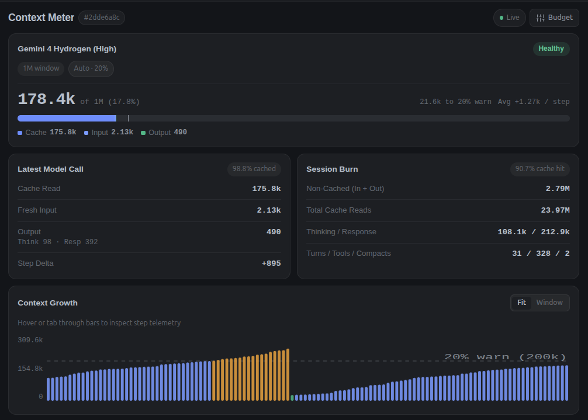
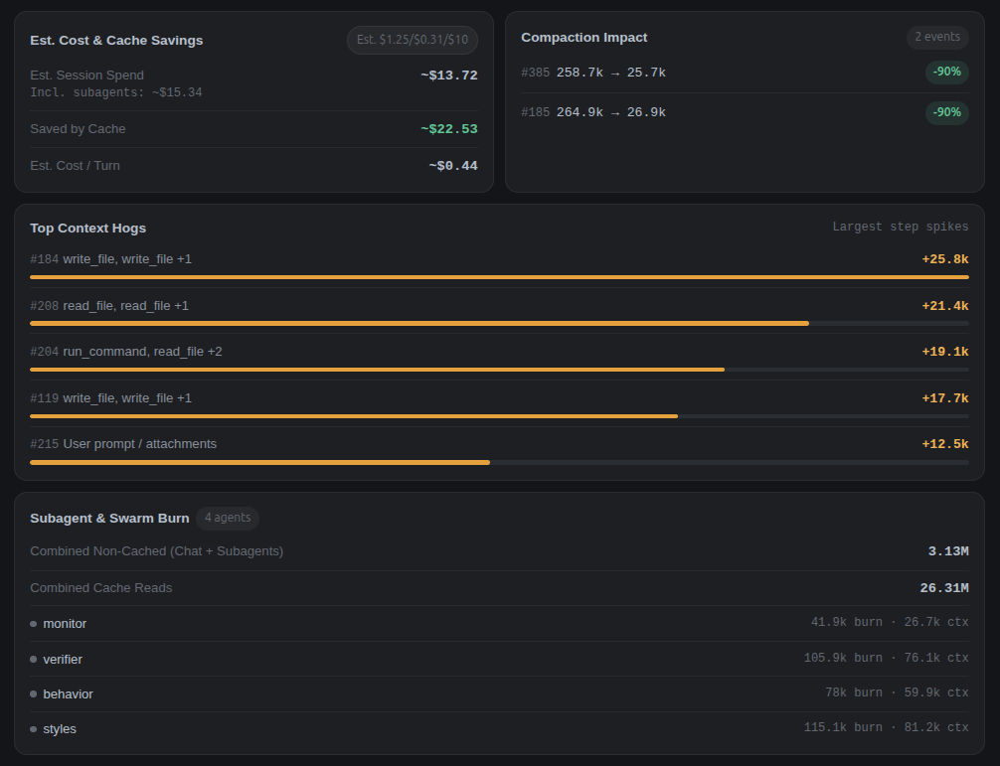
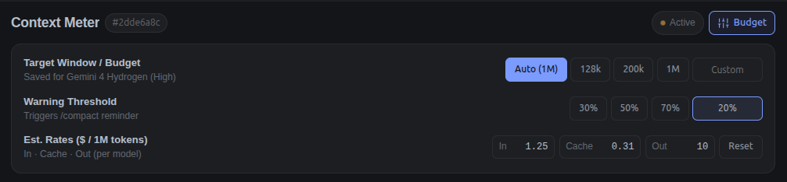

# Context Meter

**Zero-token live context window, cost & cache savings, and token telemetry monitor for Antigravity.**

Context Meter runs as an Auxiliary Pane UI sidecar (`SIDECAR_UI_ENTRYPOINT_AUX_PANE`) and reads exact per-step token telemetry directly from conversation transcripts and the local Antigravity Language Server—consuming **zero prompt tokens**.

## Screenshots

| Overview & Context Growth | Cost, Compaction, Hogs & Subagents |
| :---: | :---: |
|  |  |

**Budget, Warning Threshold & Custom Rates Settings**



## Features

- **Auto Model & Window Detection:** Identifies the active conversation's model (`Gemini`, `Claude`, `GPT-OSS`, etc.), applies the model's context window automatically, and supports custom per-model budgets.
- **Segmented Context Gauge:** Visualizes `Cache Read`, `Fresh Input`, `Output`, and in-flight `Pending` tokens against your warning threshold with headroom and burn-velocity (`Avg / step`) metrics.
- **`/compact` Threshold Reminder:** Displays an in-panel warning banner whenever context crosses your configured warning threshold (defaults to `30%`).
- **Latest Call & Session Burn:** Tracks latest cache hit rate, cumulative non-cached vs. cache-read tokens, `Thinking / Response` output split, and `Turns / Tools / Compacts`.
- **Interactive Context Growth Chart:** Inspect step-by-step context growth, compaction drops, warning threshold line, and tool activity with `Fit` (auto-scaled) and `Window` (full-scale) modes.
- **Est. Cost & Cache Savings:** Estimates session spend (including child subagents), cache savings, and average cost per turn using customizable per-model `In / Cache / Out` rates (`$/1M tokens`).
- **Compaction Impact History:** Logs each compaction event with before → after token counts and percentage drop.
- **Top Context Hogs:** Surfaces the largest per-step token spikes and the tool calls or user prompts responsible for them.
- **Subagent & Swarm Burn:** Aggregates combined non-cached/cache-read burn and live context size across active and completed child subagents.
- **Persistent Preferences:** Saves your target window/budget, warning threshold, custom rates, and chart scale locally (`localStorage` + disk config) across restarts.

## Repository & Installation

- **Repository:** https://github.com/imarufbillah/antigravity-context-meter

To install manually from source:

```bash
git clone https://github.com/imarufbillah/antigravity-context-meter.git ~/.gemini/config/plugins/context-meter
```

Then enable **Context Meter** from the Plugins section in Antigravity and open the **Context** view in the Auxiliary Pane.

## License

Licensed under the [MIT License](LICENSE).
